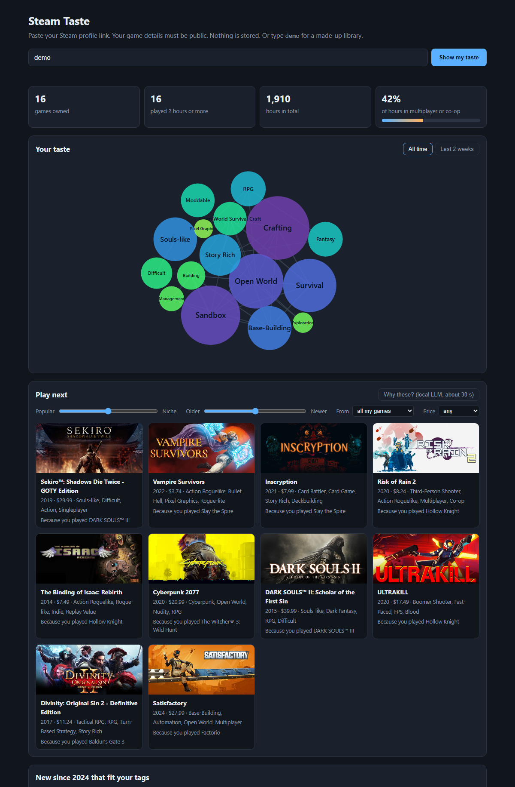

# steam-recommender


Give it a Steam library (games and hours played) and it recommends ten games you don't own. I built
recommenders on 41 million Steam reviews, from "most popular" to matrix factorisation, a local LLM reranking the
candidates and a small transformer reading a library in order, and measured all of them the same way on users
they had never seen.

The short version: the trained models win (EASE best), and the LLM did not make the ranking better while
taking 5,000 times longer. Asked to predict what players liked next year instead of a random part of their
library, every system finds less than half as much, and the models that read a library in order win there.
Below is how much, how sure, and why that is still useful to know.

| question | answer (recall@10 on held-out test users, 95% interval on the gap) |
|---|---|
| Which model finds the 20% of a library hidden from it? | EASE 0.172, ALS 0.143, popularity 0.048 (EASE over ALS: +0.017 to +0.042) |
| Does a local LLM reranking ALS help? | No: 0.149 against 0.160 (-0.038 to +0.015), 5,000 times slower |
| Which predicts what a player likes next year? | EASE + SASRec 0.088, EASE 0.064 (+0.015 to +0.033), and again on 1,000 untouched users: 0.095 against 0.070 |
| How much data does a new game need? | A week of reviews: 0.052, three times its tags (0.016) |
| Do co-likes beat tags for 2025 releases? | Not with reviews collected game by game: 0.077 against 0.085 (-0.035 to +0.016) |



_The local page ([below](#your-own-profile)) on a made-up library: type `demo` in the box, or open `/?demo`._

**Stack:** Python 3.12 · DuckDB (SQL over a 2 GB CSV) · numpy / scipy · implicit (ALS) · scikit-learn (TF-IDF) ·
Ollama (`gemma4:12b`) · PyTorch (SASRec) · pytest

## Data

The Kaggle dataset [Game Recommendations on Steam](https://www.kaggle.com/datasets/antonkozyriev/game-recommendations-on-steam)
(snapshot of August 2024): 41.2M reviews from 14.3M anonymised users on 50.9K apps, each with the date, whether
the user recommends the game, and the hours they had played by then. Reviews run from 2010 to the end of 2022.
The raw files are not in this repo.

[recs/data.py](recs/data.py) turns it into training data in SQL, with checks that stop the build on bad data
(negative hours, dates outside the expected range, reviewed apps missing from the game list):

- a **positive** is a review that recommends the game after at least 2 hours of play; one per user and game
- users with fewer than 5 positives and games with fewer than 50 users are dropped, twice over, since each
  pass can starve the other
- result: **1,495,210 users, 10,816 games, 15.8M positives**, built in about 15 seconds

## The recommenders

All of them implement one function, `recommend(library, k) -> list of app ids`, so the eval and the page can
call any of them. The first five are scored on the random split below; the last three on the time split, two of them because
they read a library in order, which only that split can judge.

1. **Popularity** ([recs/popularity.py](recs/popularity.py)): the games most training users liked. The floor.
2. **Content** ([recs/content.py](recs/content.py)): TF-IDF over the games' Steam tags, a profile weighted by
   `log1p(hours)` of what you played, cosine similarity. Needs no other users.
3. **ALS** ([recs/als.py](recs/als.py)): implicit-feedback matrix factorisation trained on 1.5M users, with
   confidence growing with hours played. A new user is never trained in: their vector is solved from their
   library against the fixed game vectors, so one library is enough.
4. **EASE** ([recs/ease.py](recs/ease.py)): a game-to-game weight matrix with a closed-form solution, one
   10,816 x 10,816 matrix inverse and no iterations (Steck, 2019). Added after the first round, when I asked
   what more this data could give.
5. **gemma4 reranker** ([recs/rerank.py](recs/rerank.py)): candidates from ALS (and tags), reordered by
   `gemma4:12b` running locally, with one sentence per pick on why. The answer goes through Ollama's structured
   outputs with a JSON schema whose only allowed ids are the candidates, so it **cannot** recommend a game that
   doesn't exist or isn't in the list.
6. **Transitions** ([recs/sequence.py](recs/sequence.py)): over likes in date order, how often each game was
   followed by each other one; a user's latest games say most. It nudges EASE's candidates.
7. **SASRec** ([eval/sasrec.py](eval/sasrec.py), [recs/sasrec_np.py](recs/sasrec_np.py)): a two-layer causal
   transformer over the last 50 likes, trained in PyTorch on a GPU and run in numpy on the page.
8. **LightGCN** ([eval/lightgcn.py](eval/lightgcn.py)): a graph neural network over the player-game like graph,
   as an eval only.

## Evaluation

Before any result existed, I picked 1000 validation and 1000 test users (at least 10 positives each), took them
out of training, and hid 20% of each one's liked games (at least 2). The split is committed in
[eval/split.json](eval/split.json) and the script that wrote it refuses to overwrite it. Every setting (ALS size,
the prompt, which candidates gemma4 sees) was chosen on the validation users; each test number below comes from
a single run, made once, at the end.

The question for every system: are the hidden games in its top 10?

```bash
python -m eval.run_eval --set test --systems popularity,content,als,hybrid --users 1000
```

**Test, 1000 users:**

| system | recall@10 | ndcg@10 | different games recommended | mean popularity rank |
|---|---|---|---|---|
| popularity | 0.048 | 0.031 | 18 | 6 |
| content (tags) | 0.027 | 0.021 | 2928 | 3262 |
| ALS | 0.143 | 0.102 | 648 | 173 |
| **EASE** | **0.172** | **0.140** | 1138 | 303 |
| ALS + content, alternating | 0.100 | 0.075 | 2300 | 1639 |
| content, 2026 tags x popularity | 0.083 | 0.058 | 730 | 206 |

At least one hidden game is in the top 10 for **43% of users with EASE** (37% with ALS, 15% with popularity).
For comparison with papers: ranked against 100 random games instead of the whole catalogue, the protocol many
papers use, EASE's hit rate is 84% (validation). That protocol is known to flatter and even reorder systems
(Krichene and Rendle, 2020), so the full-catalogue numbers are the ones I stand behind.

_Recall@10: hidden games found in the top 10, out of the most that could fit. Mean popularity rank: where the
recommended games sit in the popularity list (1 = most played), so low means a popularity bias._

**The LLM rows, test, the first 100 of the same users** (gemma4 takes about 10 s per user):

| system | recall@10 | ndcg@10 | different games | s / user |
|---|---|---|---|---|
| popularity | 0.055 | 0.038 | 14 | 0 |
| **ALS** | **0.160** | **0.127** | 391 | 0.002 |
| ALS + content, alternating | 0.120 | 0.102 | 664 | 0.002 |
| gemma4 reorders ALS + content (50 candidates) | 0.137 | 0.102 | 619 | 9.9 |
| gemma4 reorders ALS's top 20 | 0.149 | 0.103 | 424 | 9.2 |
| gemma4 alone, no candidates | 0.041 | 0.035 | 196 | 3.5 |

_Same 100 users for every row; at this size one user moves recall by about 0.01, so read the gaps, not the
third decimal._

**How big a gap is real.** Every system is scored on the same users, so each gap can be resampled user by user
(paired bootstrap, 10,000 draws, [eval/intervals.py](eval/intervals.py)). An interval that holds 0 means this
eval cannot tell the two apart:

| comparison (test) | users | recall@10 gap | 95% interval |
|---|---|---|---|
| ALS against EASE | 1000 | -0.030 | -0.042 to -0.017 |
| popularity against ALS | 1000 | -0.095 | -0.110 to -0.080 |
| ALS + content, alternating, against ALS | 1000 | -0.043 | -0.053 to -0.034 |
| gemma4 reorders ALS's top 20, against ALS | 100 | -0.011 | -0.038 to +0.015 |
| gemma4 reorders ALS + content, against that list | 100 | +0.017 | -0.011 to +0.047 |
| gemma4 alone, against ALS | 100 | -0.120 | -0.168 to -0.075 |
| cold start: 2026 tags x popularity, against tags | 125 | +0.016 | +0.000 to +0.040 |
| learned second stage, against EASE ([findings](docs/findings.md#a-learned-second-stage-did-not-beat-ease)) | 1000 | +0.001 | -0.003 to +0.006 |

```bash
python -m eval.intervals eval/results/<file>.json ease als    # first system is the base
```

## What I found

The short list; each line links to its numbers in [docs/findings.md](docs/findings.md). What the page's model is
for, how well it does and where it falls short is summed up in its [model card](docs/model_card.md).

**The random split**

- [EASE beats ALS by a fifth (0.172 against 0.143), with no training loop.](docs/findings.md#ease-beats-als-by-a-fifth)
- [Its lead grows with the library: +0.020 at 10 to 14 games, +0.046 at 30 or more.](docs/findings.md#eases-lead-grows-with-the-library)
- [ALS finds three times what popularity does, from 648 different games instead of 18.](docs/findings.md#als-is-three-times-better-than-popularity)
- [Tags alone lose to popularity, because the games people hide are mostly popular.](docs/findings.md#tags-alone-lose-to-popularity-on-this-metric)
- [Weighting by playtime (as Steam is said to) did not help on val, and idle games skewed it on a real library.](docs/findings.md#weighting-by-playtime-did-not-help)
- [A gradient boosted second stage tied EASE, with 12% more of the catalogue reached.](docs/findings.md#a-learned-second-stage-did-not-beat-ease)

**The local LLM**

- [gemma4 reordering ALS's picks was at best a tie, 5,000 times slower.](docs/findings.md#gemma4-did-not-beat-the-model-it-was-given)
- [Alone, gemma4 named titles of which 20% are not in Steam's list; the candidate schema keeps it safe.](docs/findings.md#gemma4-alone-recommends-from-memory-and-memory-is-not-a-catalogue)
- [So the model ranks and gemma4 explains: 97% of its reasons name a game the player played.](docs/findings.md#so-i-split-the-jobs-als-ranks-gemma4-explains)
- [On the page's own picks it holds at 96%; it names the card's exact "because" game in 47% of reasons.](docs/findings.md#the-reasons-hold-on-the-pages-own-picks)

**Predicting the next year (the time split)**

- [Predicting the next year, every number falls by more than half, and the random split is the one papers report.](docs/findings.md#asked-to-predict-the-future-every-number-falls-by-more-than-half)
- [Three recency tricks won on val and not on test.](docs/findings.md#weighing-recent-likes-more-helped-on-val-and-not-on-test)
- [Order helps: transition counts nudging EASE find 14% more on test.](docs/findings.md#order-helps-and-it-held-on-test)
- [SASRec reads the library in order; with EASE it finds 38% more than EASE, with less popular picks.](docs/findings.md#a-small-transformer-reading-the-library-in-order-sasrec-is-the-best-system-on-the-time-split)
- [That held on 1,000 untouched users: 0.095 against 0.070.](docs/findings.md#the-headline-held-on-users-no-system-had-seen)
- [With only three games shown, the same order holds.](docs/findings.md#with-three-games-the-order-still-holds)
- [A rerank for variety cost nothing measurable, so the page uses it.](docs/findings.md#variety-cost-nothing-measurable)
- [LightGCN, a graph neural network, landed below EASE and level with ALS.](docs/findings.md#a-graph-neural-network-did-not-beat-ease-either)
- [Each game's 200 largest weights in float16 (8 MB, not 447) find the same as the full EASE.](docs/findings.md#an-8-mb-ease-finds-the-same-as-the-447-mb-one)

**New games**

- [Cold start: tags found almost nothing for games the model never saw.](docs/findings.md#cold-start-tags-alone-found-nothing-fresh-tags-times-popularity-found-a-little)
- [Descriptions (bge-m3) and a description-to-ALS bridge beat tags alone; in a row of new games, tags x popularity wins clearly.](docs/findings.md#descriptions-beat-tags-alone-for-a-row-of-new-games-tags-times-popularity-wins)
- [Warm start: one week of reviews per new game beats every tag, three times over.](docs/findings.md#warm-start-a-games-first-week-beats-every-tag)
- [A 2026 store catalogue fills in 2023 to 2026 games (once its broken header is fixed).](docs/findings.md#a-store-catalogue-from-october-2026)
- [Collected 2025 reviews, authors hashed, were too sparse for co-likes to beat tags.](docs/findings.md#public-store-reviews-anonymised)

## Your own profile

```bash
python -m recs.profile https://steamcommunity.com/id/<name>
```

[recs/steam.py](recs/steam.py) reads one library from a profile link, only at that person's request (as the
Steam Web API terms require), with your own key in `.env`; nothing is stored. [recs/profile.py](recs/profile.py)
then prints, in about 3 seconds once the EASE weights are cached:

- **your taste**: Steam tags weighted by how rare they are across 130K games and by `sqrt(hours)`. Tags that
  describe how a game is played (Multiplayer, Free to Play, Singleplayer) are left out of the taste and shown as
  a separate share: how many of your hours went to multiplayer or co-op games.
- **play next**: the page's ranking (EASE + SASRec, the latest played games last in the order it reads), with
  programs filtered out by their Steam genre.
- **new since 2024**: games the 2022 model never saw, ranked by tag similarity times `log1p(positive reviews)`.

Or as a page, standard library only:

```bash
python -m recs.web      # http://127.0.0.1:8000
```

Paste a profile link and it draws the taste as a bubble graph (D3): one bubble per tag, sized by its share,
linked to the tags that describe the same games across the store (Jaccard over well-reviewed games), so related
tastes pull together. A switch shows the last two weeks instead of all time, which is where a change in taste
shows up. Below it, cards for "play next" and "new since 2024", with links to the store pages and the price from the
October 2026 catalogue. "Play next" can rank from all your games or only the last two weeks' (a change of taste shows
there first), and can be limited to free games or a price. Two sliders, popular to niche and
older to newer, borrowed from Steam's own interactive recommender, re-sort the ranker's top 60 in the page: each
adds the game's percentile among those 60 (review count, release year) to the ranker's order, so at the middle
the order is untouched. "Niche" is relative: EASE only knows games with 50 or more reviews in 2022, so the far end is less known,
not obscure. The candidates are EASE nudged by SASRec, the pair that did best on the time split's test, reading the
library in the order Steam's API gives as each game's last-played time (EASE + transitions if the SASRec weights
are not there). On the demo library a recent run of Slay the Spire brings Inscryption, Vampire Survivors and
ULTRAKILL into the top ten; with transitions alone the nudge also lifted the games that were rising in 2021 and
2022 (Bloons TD 6, Among Us), which SASRec does not. Each card also says which of your games led to it:
EASE's score is a sum over your library, so its biggest term names the game, exactly and without a model call
(on the demo, Sekiro because of Dark Souls III, Inscryption because of Slay the Spire). The order is then
reranked for tag variety ([how much it costs](docs/findings.md#variety-cost-nothing-measurable)). A button
asks gemma4 for one line per "play next" card, from the games you played (schema-limited to those ten, in
the page's order); the 2023 to 2026 games it names come from the store catalogue, so a library full of recent games
still reads correctly. Ollama is started for that request and stopped right after.

**Play together**: a friend's profile link (theirs to give; `demo2` is a made-up one) gives the multiplayer and
co-op games you both own, by your hours together, and new ones by least misery, the usual baseline for a group:
each game ranks by the worse of its two places in your own rankings, so neither of you gets one you would not
like. A game one of you owns counts as top for that one, and its card says who owns it.

On a laptop the page starts in about 1.2 s (EASE trains itself in about 20 s the first time), draws a library in
about 0.3 s and holds about 770 MB, most of it EASE's 10,816 x 10,816 matrix (`python -m eval.bench_page`). A
test fails if one page takes over a second on a store of real size.

Without the 2 GB of reviews: `python -m recs.bundle` packs what the page reads (both catalogues, SASRec's weights
and a small EASE, see above) into `dist/demo-data.zip`, 19.8 MB with a notice of the data's sources and licenses.
Unzipped into the repository's folder, `python -m recs.web` runs with no download and no training.

Trying it on my own library found two problems the offline eval could not: a wallpaper program in the top 10,
and a genre I had put about 2,000 hours into missing from the taste entirely. Hours were weighted by
`log1p`, which squashed them so hard that a hundred short games outweighed three very long ones; `sqrt` fixed it.
Playtime is still a rough signal: idle games left running inflate it.

## Running it

```bash
python -m venv .venv && .venv/Scripts/pip install ".[dev]"
python -m recs.data path/to/steam_game_recommendations_archive.zip   # extract, check, build (~15 s)
python -m recs.data --store path/to/steam_game_price.zip             # 2026 store catalogue (~2 min)
python -m eval.run_eval --set val --systems popularity,content,als,hybrid
ollama pull gemma4:12b                                              # only for the LLM rows
python -m eval.run_eval --set val --systems rerank-als20 --users 100
python -m eval.time_split --set val                                 # the time split (frozen in eval/time_split.json)
python -m eval.sasrec --export && pip install ".[seq]" && python -m eval.sasrec --set val   # SASRec, wants a GPU
python -m eval.lightgcn --epochs 40 --batch 131072 --lr 0.01         # LightGCN on the same export, val and test
python -m eval.explain_eval --set val --users 100   # how grounded the reasons are
python -m recs.recommend --library lib.json   # the page's picks with gemma4's reasons, no Steam key
```

On Windows with more than 24 logical cores, OpenBLAS (as shipped with numpy) crashes inside implicit; the
package sets `OPENBLAS_NUM_THREADS=1` before numpy loads.

## Tests

```bash
pytest
```

91 tests, no network, no model, no real data: the SQL build and the quality checks on tiny CSVs, the
frozen splits (random and in time) and the latest-N view, the metrics and their bootstrap intervals, the variety rerank, the transition counts and recency weights, the description recommender and its bridge to ALS, the small EASE (largest weights by size, negative ones kept), each recommender (owned games never recommended, unknown games ignored, empty
libraries fall back to popularity), the reranker's schema and its fallback when the model fails or returns
duplicates, the store catalogue's broken header, the collector (paging, hashing, no raw ids), the popularity weight, reading a profile link (vanity and numeric, private libraries), the taste profile (rare tags over common ones, long-played over many short games), the non-game filter, the tag links for the graph, the page's data (owned games and programs never recommended, reasons in the page's order, the demo library calling no one, the latest played games weighing most, the game behind each card, Steam's errors reaching the page without the API key, one page in under a second, the last two weeks' own picks, play together by least misery), SASRec's numpy forward pass (no step sees a later game), the explainer keeping ALS's order and checking which sentences are grounded, title matching with ™ and odd spacing, and stopping Ollama with its child process.

## What's next

- A Telegram bot in front of the same engine
- For new releases, reviewers with more of their library: per-game review sampling gives each reviewer a
  handful of links, which the fresh eval shows is not enough to beat tags

Not affiliated with Valve. No user data is stored; the dataset's user ids are anonymised.

The code is under the [MIT license](LICENSE). The datasets, Steam's reviews and the game images are not part of
this repository and keep their own terms.
